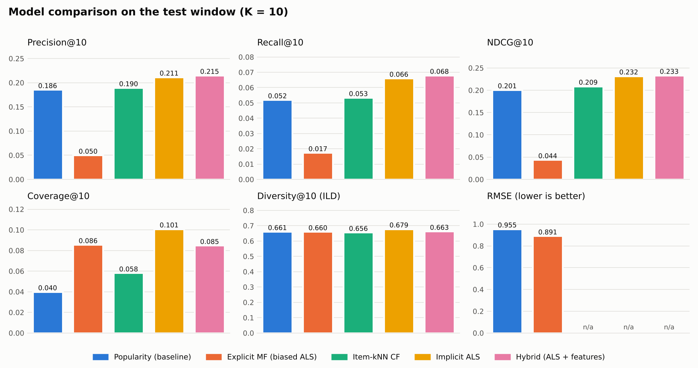

# Model Evaluation - test window

- Generated: 2026-11-08T07:06:23+00:00
- Fit window: train + val (ratings before 2000-12-29 23:43 UTC); test window: everything after.
- Relevant = held-out rating >= 4; candidates = items seen in the fit window, minus each user's already-rated items.
- Users evaluated: 1158 warm users with >= 1 relevant test item (cold-start users excluded: 29; test ratings of movies new in the test window: 90); candidate items: 3678; rating pairs for RMSE/MAE: 95723.
- Coverage = share of candidate items recommended to anyone; Diversity = mean pairwise genre-cosine distance inside a list; Novelty = mean -log2(popularity share).
- RMSE / MAE only for models that predict explicit ratings (popularity uses the damped item mean).

## K = 5

| model | precision@5 | recall@5 | ndcg@5 | hit_rate@5 | coverage@5 | diversity@5 | novelty@5 | rmse | mae |
|---|---|---|---|---|---|---|---|---|---|
| Popularity (baseline) | 0.2000 | 0.0287 | 0.2111 | 0.4879 | 0.0258 | 0.5880 | 8.5181 | 0.9554 | 0.7573 |
| Explicit MF (biased ALS) | 0.0359 | 0.0062 | 0.0307 | 0.1459 | 0.0536 | 0.6342 | 15.9551 | 0.8910 | 0.6975 |
| Item-kNN CF | 0.2112 | 0.0313 | 0.2249 | 0.5009 | 0.0400 | 0.6159 | 8.7535 | — | — |
| Implicit ALS | 0.2313 | 0.0384 | 0.2446 | 0.5475 | 0.0786 | 0.6581 | 8.8142 | — | — |
| Hybrid (ALS + features) | 0.2318 | 0.0404 | 0.2429 | 0.5509 | 0.0623 | 0.6343 | 8.7585 | — | — |

## K = 10

| model | precision@10 | recall@10 | ndcg@10 | hit_rate@10 | coverage@10 | diversity@10 | novelty@10 | rmse | mae |
|---|---|---|---|---|---|---|---|---|---|
| Popularity (baseline) | 0.1856 | 0.0520 | 0.2009 | 0.6244 | 0.0400 | 0.6613 | 8.6402 | 0.9554 | 0.7573 |
| Explicit MF (biased ALS) | 0.0500 | 0.0174 | 0.0440 | 0.3092 | 0.0856 | 0.6604 | 15.1782 | 0.8910 | 0.6975 |
| Item-kNN CF | 0.1896 | 0.0534 | 0.2090 | 0.6019 | 0.0582 | 0.6559 | 8.8545 | — | — |
| Implicit ALS | 0.2115 | 0.0661 | 0.2319 | 0.6589 | 0.1009 | 0.6785 | 8.9009 | — | — |
| Hybrid (ALS + features) | 0.2151 | 0.0680 | 0.2333 | 0.6779 | 0.0848 | 0.6630 | 8.8555 | — | — |

## How sure are we? 95% bootstrap confidence intervals (1000 resamples of users)

`significant` = the paired difference to the popularity baseline has a CI that excludes 0.

| model | ndcg@10 | ci_low | ci_high | diff_vs_popularity | diff_ci_low | diff_ci_high | significant |
|---|---|---|---|---|---|---|---|
| Popularity (baseline) | 0.2009 | 0.1878 | 0.2152 | 0.0000 | 0.0000 | 0.0000 | - |
| Explicit MF (biased ALS) | 0.0440 | 0.0392 | 0.0491 | -0.1569 | -0.1691 | -0.1451 | yes |
| Item-kNN CF | 0.2090 | 0.1946 | 0.2231 | 0.0081 | -0.0002 | 0.0161 | no |
| Implicit ALS | 0.2319 | 0.2182 | 0.2468 | 0.0310 | 0.0223 | 0.0400 | yes |
| Hybrid (ALS + features) | 0.2333 | 0.2193 | 0.2480 | 0.0324 | 0.0241 | 0.0407 | yes |

| model | hit_rate@10 | ci_low | ci_high | diff_vs_popularity | diff_ci_low | diff_ci_high | significant |
|---|---|---|---|---|---|---|---|
| Popularity (baseline) | 0.6244 | 0.5984 | 0.6511 | 0.0000 | 0.0000 | 0.0000 | - |
| Explicit MF (biased ALS) | 0.3092 | 0.2824 | 0.3342 | -0.3152 | -0.3454 | -0.2850 | yes |
| Item-kNN CF | 0.6019 | 0.5743 | 0.6295 | -0.0225 | -0.0458 | -0.0017 | yes |
| Implicit ALS | 0.6589 | 0.6330 | 0.6857 | 0.0345 | 0.0121 | 0.0561 | yes |
| Hybrid (ALS + features) | 0.6779 | 0.6502 | 0.7055 | 0.0535 | 0.0328 | 0.0734 | yes |

Rating error (lower is better; a negative difference = better than the damped item mean):

| model | metric | value | ci_low | ci_high | diff_vs_popularity | diff_ci_low | diff_ci_high | significant |
|---|---|---|---|---|---|---|---|---|
| Popularity (baseline) | rmse | 0.9554 | 0.9326 | 0.9772 | 0.0000 | 0.0000 | 0.0000 | - |
| Popularity (baseline) | mae | 0.7573 | 0.7392 | 0.7747 | 0.0000 | 0.0000 | 0.0000 | - |
| Explicit MF (biased ALS) | rmse | 0.8910 | 0.8711 | 0.9129 | -0.0644 | -0.0808 | -0.0491 | yes |
| Explicit MF (biased ALS) | mae | 0.6975 | 0.6824 | 0.7137 | -0.0599 | -0.0714 | -0.0485 | yes |

## By user history (ratings before the test window), K = 10

| segment | users | model | ndcg@10 | hit_rate@10 |
|---|---|---|---|---|
| 1-49 prior ratings | 232 | Popularity (baseline) | 0.2140 | 0.6293 |
| 1-49 prior ratings | 232 | Explicit MF (biased ALS) | 0.0568 | 0.3405 |
| 1-49 prior ratings | 232 | Item-kNN CF | 0.2310 | 0.6379 |
| 1-49 prior ratings | 232 | Implicit ALS | 0.2542 | 0.6810 |
| 1-49 prior ratings | 232 | Hybrid (ALS + features) | 0.2518 | 0.6940 |
| 50-199 prior ratings | 463 | Popularity (baseline) | 0.2083 | 0.5853 |
| 50-199 prior ratings | 463 | Explicit MF (biased ALS) | 0.0436 | 0.3153 |
| 50-199 prior ratings | 463 | Item-kNN CF | 0.2185 | 0.5810 |
| 50-199 prior ratings | 463 | Implicit ALS | 0.2433 | 0.6479 |
| 50-199 prior ratings | 463 | Hybrid (ALS + features) | 0.2439 | 0.6587 |
| 200+ prior ratings | 463 | Popularity (baseline) | 0.1870 | 0.6609 |
| 200+ prior ratings | 463 | Explicit MF (biased ALS) | 0.0379 | 0.2873 |
| 200+ prior ratings | 463 | Item-kNN CF | 0.1885 | 0.6048 |
| 200+ prior ratings | 463 | Implicit ALS | 0.2094 | 0.6587 |
| 200+ prior ratings | 463 | Hybrid (ALS + features) | 0.2134 | 0.6890 |

